# PawRescue — Pet Adoption & Rescue Platform

PawRescue is a Django-based pet adoption and rescue platform that allows users to browse available pets, search and filter pets, submit adoption requests, manage favorites, and track adoption request status.

The project also provides a REST API built with Django REST Framework for pet and adoption request management.


## Screenshots

### Home Page

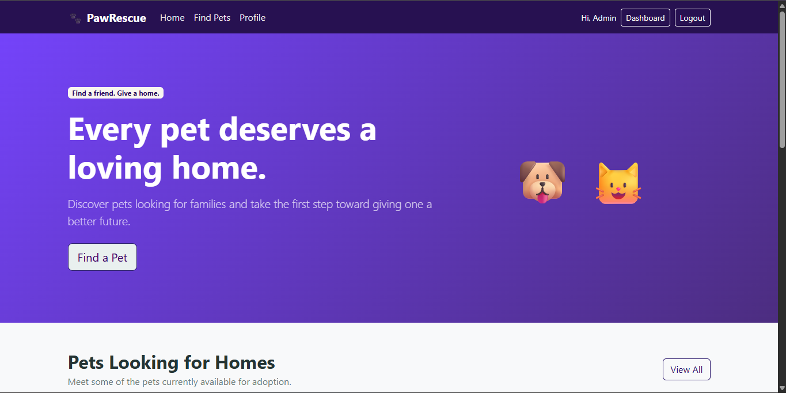

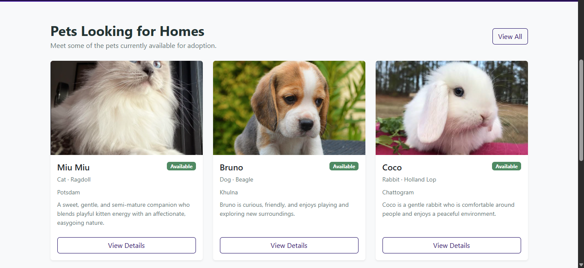

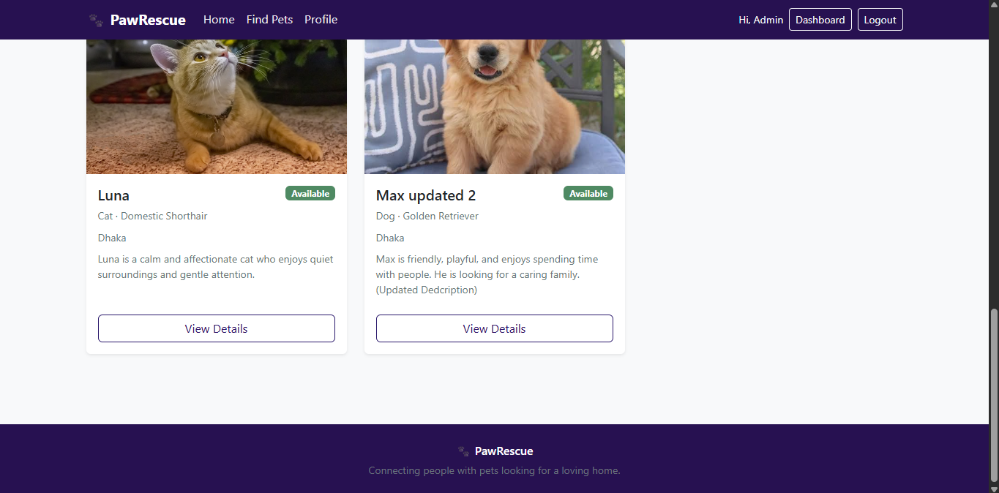


### Pet Listing

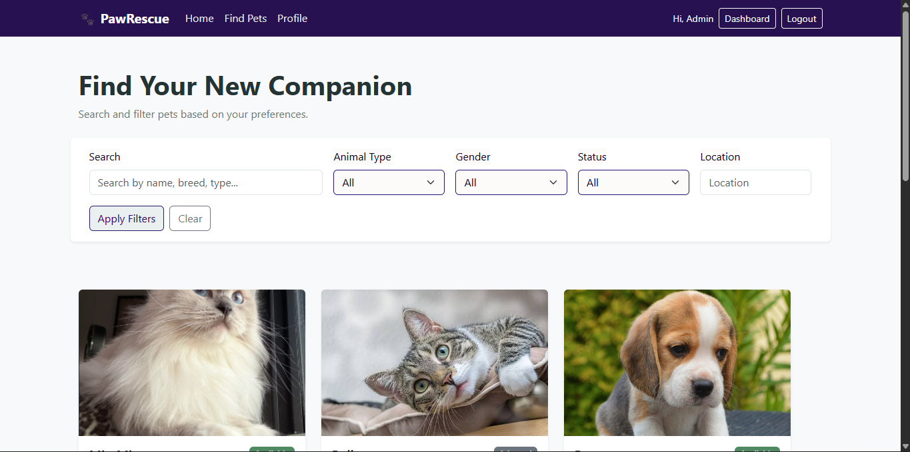

### Search & Filters

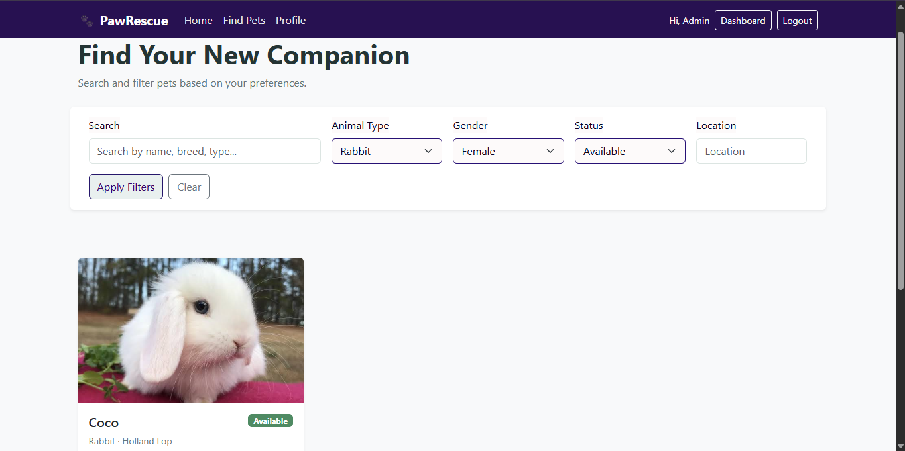

### Pet Details

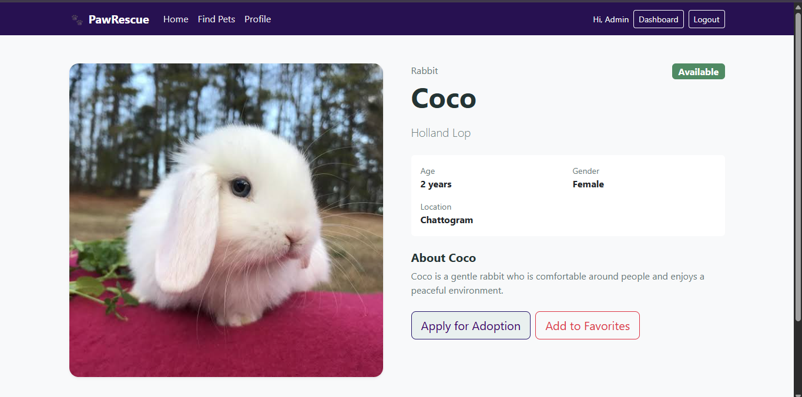

### User Dashboard

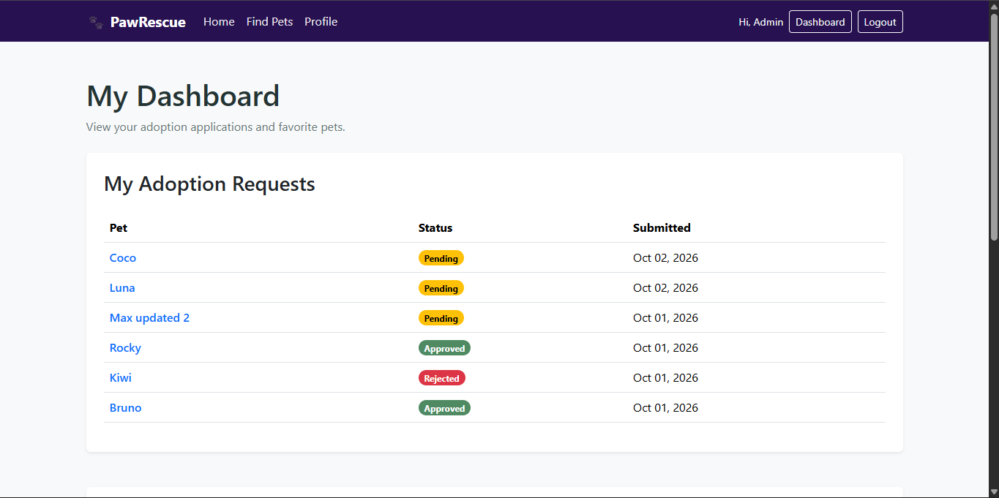

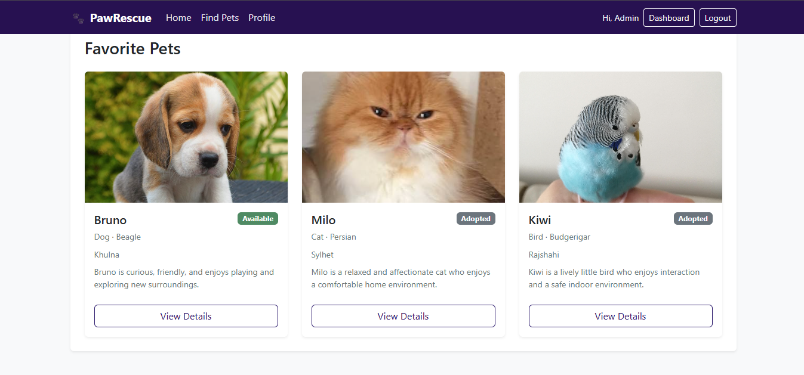

### Adoption Application

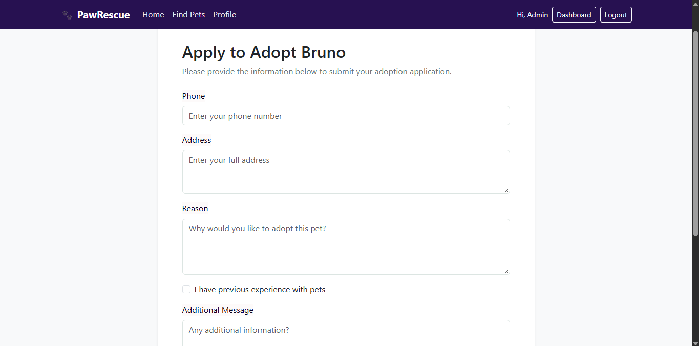

### Django Admin

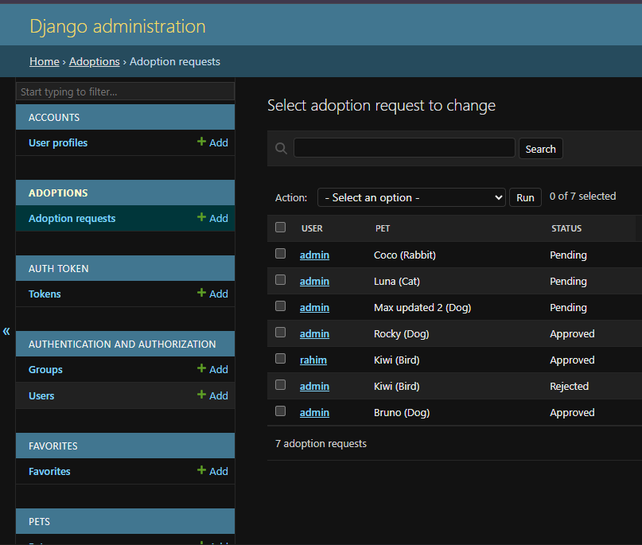

### Login Page

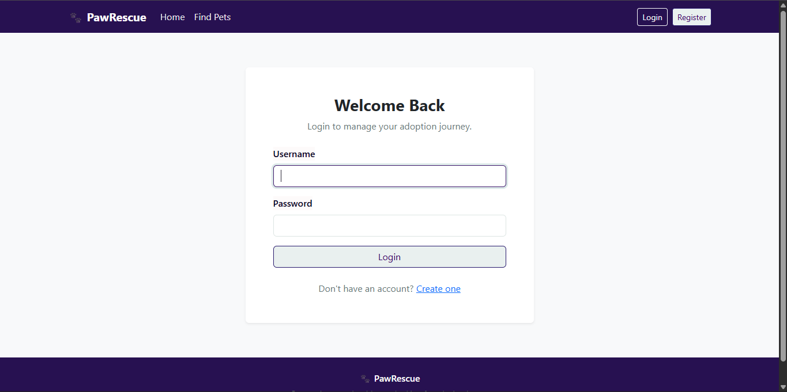

### Registration Page

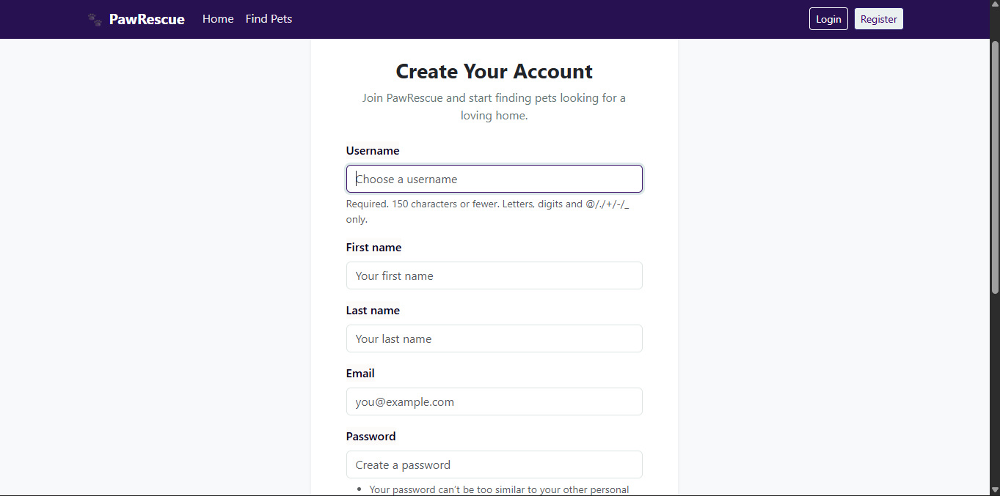


## Features

### User Authentication

- User registration
- User login
- User logout
- User profile
- Authentication-protected adoption features

### Pet Browsing

- Browse available pets
- Pet detail pages
- Pet images
- Animal type
- Breed
- Age
- Gender
- Location
- Description
- Adoption status
- Search
- Filtering
- Pagination
- Responsive Bootstrap UI

### Adoption Workflow

- Submit adoption requests
- Phone number and address collection
- Adoption reason
- Previous pet experience
- Optional additional message
- User dashboard
- Pending, Approved, and Rejected statuses
- Duplicate pending-request prevention
- Only available pets can receive adoption requests
- Approved adoption changes the pet status to Adopted
- Other pending requests for the same pet are automatically rejected

### Favorites

- Add pets to favorites
- Remove pets from favorites
- View favorite pets from the dashboard

### REST API

- Django REST Framework
- Token authentication
- Pet CRUD API
- Adoption request API
- Search
- Filtering
- Ordering
- Pagination
- User-specific adoption request access
- Staff-only pet management
- API validation and permissions


## REST API — Postman

### API Authentication

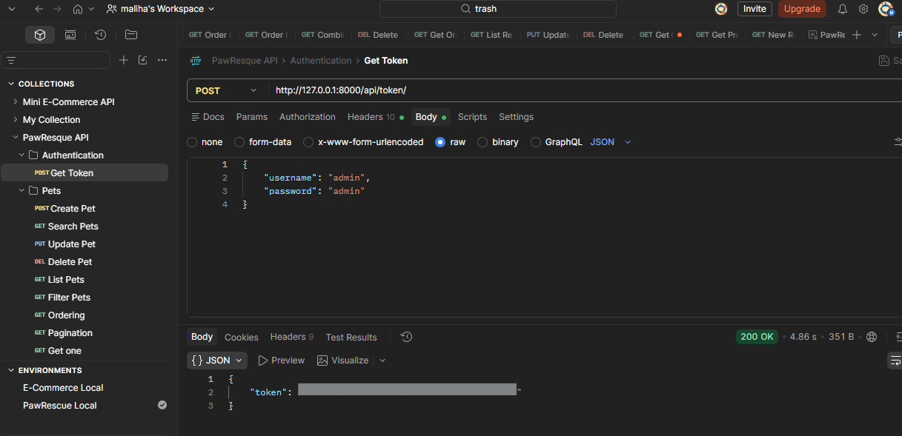

### Pet API

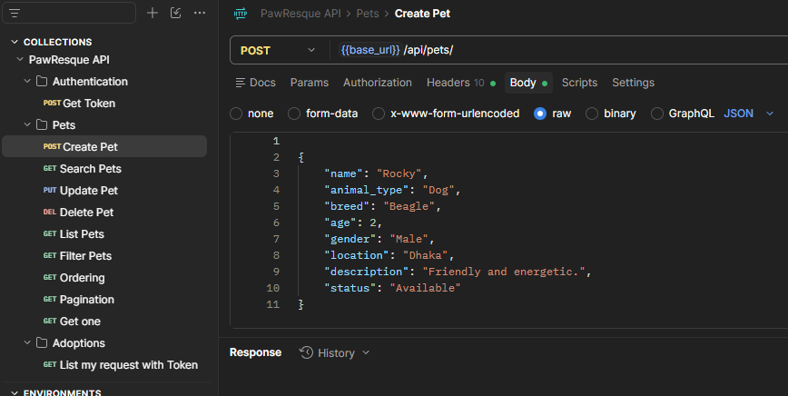


### Adoption API

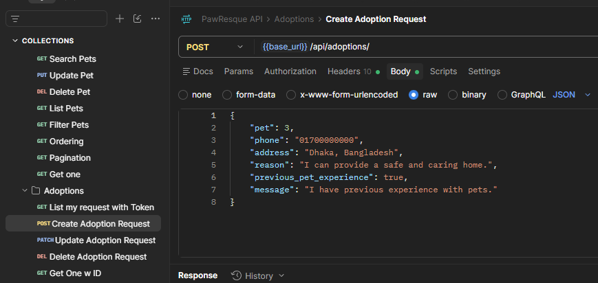


## Demo Video

A complete walkthrough of the PawRescue website, adoption workflow, Django Admin, and REST API is available below.

[Watch the PawRescue Demo](https://drive.google.com/file/d/1QbIJK4pM609N2UqUJAjI1-_m_7Rv4bZr/view?usp=sharing)


## Technology Stack

- Python 3.12
- Django 6.1
- Django REST Framework
- django-filter
- PostgreSQL
- Bootstrap 5
- HTML5
- CSS3
- Git
- GitHub
- Postman

## Project Structure

```text
pet-adoption-platform/
│
├── accounts/
│   ├── forms.py
│   ├── models.py
│   ├── urls.py
│   └── views.py
│
├── pets/
│   ├── api/
│   │   ├── permissions.py
│   │   ├── serializers.py
│   │   ├── tests.py
│   │   ├── urls.py
│   │   └── views.py
│   ├── models.py
│   ├── urls.py
│   └── views.py
│
├── adoptions/
│   ├── api/
│   │   ├── serializers.py
│   │   ├── tests.py
│   │   ├── urls.py
│   │   └── views.py
│   ├── admin.py
│   ├── forms.py
│   ├── models.py
│   ├── services.py
│   ├── urls.py
│   └── views.py
│
├── favorites/
│   ├── models.py
│   ├── urls.py
│   └── views.py
│
├── config/
│   ├── settings.py
│   ├── urls.py
│   └── ...
│
├── templates/
├── static/
├── media/
├── .env
├── .env.example
├── .gitignore
├── manage.py
├── requirements.txt
└── README.md
```

## Local Setup

### 1. Clone the repository

```bash
git clone <your-github-repository-url>
cd pet-adoption-platform
```

### 2. Create a virtual environment

Windows Git Bash:

```bash
python -m venv venv
```

Activate it:

```bash
source venv/Scripts/activate
```

### 3. Install dependencies

```bash
pip install -r requirements.txt
```

### 4. Create the PostgreSQL database

Open PostgreSQL or pgAdmin and create a database for the project.

Example:

```sql
CREATE DATABASE pawrescue_db;
```

### 5. Configure environment variables

Create a `.env` file in the project root.

Example:

```env
SECRET_KEY=your-secret-key
DEBUG=True

DB_NAME=pawrescue_db
DB_USER=postgres
DB_PASSWORD=your-postgresql-password
DB_HOST=localhost
DB_PORT=5432
```

Do not commit the `.env` file to GitHub.

### 6. Run migrations

```bash
python manage.py migrate
```

### 7. Create an admin user

```bash
python manage.py createsuperuser
```

### 8. Start the development server

```bash
python manage.py runserver
```

Open:

```text
http://127.0.0.1:8000/
```

Admin:

```text
http://127.0.0.1:8000/admin/
```

## Main Website URLs

| Page | URL |
|---|---|
| Home | `/` |
| Pet List | `/pets/` |
| Pet Detail | `/pets/<id>/` |
| Login | `/accounts/login/` |
| Register | `/accounts/register/` |
| Profile | `/accounts/profile/` |
| Dashboard | `/dashboard/` |
| Adoption Form | `/pets/<id>/apply/` |
| Admin | `/admin/` |

## REST API

### Authentication

Get an authentication token:

```http
POST /api/token/
```

Request:

```json
{
    "username": "your_username",
    "password": "your_password"
}
```

Response:

```json
{
    "token": "your-token"
}
```

For protected endpoints use:

```http
Authorization: Token YOUR_TOKEN
```

## Pet API

### List Pets

```http
GET /api/pets/
```

### Get Pet

```http
GET /api/pets/<id>/
```

### Create Pet

```http
POST /api/pets/
```

Staff authentication is required.

### Update Pet

```http
PUT /api/pets/<id>/
```

Staff authentication is required.

### Delete Pet

```http
DELETE /api/pets/<id>/
```

Staff authentication is required.

### Search

```http
GET /api/pets/?search=golden
```

### Filter by Animal Type

```http
GET /api/pets/?animal_type=Dog
```

### Filter by Gender

```http
GET /api/pets/?gender=Male
```

### Filter by Status

```http
GET /api/pets/?status=Available
```

### Ordering

```http
GET /api/pets/?ordering=name
```

Descending order:

```http
GET /api/pets/?ordering=-name
```

### Pagination

```http
GET /api/pets/?page=2
```

## Adoption API

All adoption endpoints require authentication.

### List My Adoption Requests

```http
GET /api/adoptions/
```

Only the authenticated user's requests are returned.

### Create Adoption Request

```http
POST /api/adoptions/
```

Example:

```json
{
    "pet": 1,
    "phone": "01700000000",
    "address": "Dhaka, Bangladesh",
    "reason": "I can provide a safe and caring home.",
    "previous_pet_experience": true,
    "message": "I have previous experience with pets."
}
```

The following fields are assigned by the server:

- user
- status
- created_at

### Get Adoption Request

```http
GET /api/adoptions/<id>/
```

### Update Pending Adoption Request

```http
PATCH /api/adoptions/<id>/
```

Only pending requests can be updated.

### Delete Pending Adoption Request

```http
DELETE /api/adoptions/<id>/
```

Only pending requests can be deleted.

## Adoption Business Rules

The application enforces the following rules:

1. Only available pets can receive adoption requests.
2. A user cannot create multiple pending requests for the same pet.
3. The user field is assigned from the authenticated account.
4. Users can only access their own adoption requests through the API.
5. Adoption status cannot be changed by normal API users.
6. When an administrator approves an adoption:
   - The request becomes Approved.
   - The pet becomes Adopted.
   - Other pending requests for the same pet become Rejected.
7. Approved and rejected requests cannot be modified or deleted through the normal user API.

## API Permissions

### Public

Users can:

- View pets
- Search pets
- Filter pets
- Order pets
- Paginate pet results

### Authenticated Users

Users can:

- Create adoption requests
- View their own adoption requests
- Update pending requests
- Delete pending requests

### Staff Users

Staff users can:

- Create pets
- Update pets
- Delete pets
- Manage adoption requests through Django Admin

## Testing

Run all Django tests:

```bash
python manage.py test
```

Run system checks:

```bash
python manage.py check
```

Check migrations:

```bash
python manage.py showmigrations
```

Create migrations when models change:

```bash
python manage.py makemigrations
```

Apply migrations:

```bash
python manage.py migrate
```

## Postman

A Postman collection can be organized as:

```text
PawRescue API
│
├── Authentication
│   └── Get Token
│
├── Pets
│   ├── List Pets
│   ├── Search Pets
│   ├── Filter Pets
│   ├── Get Pet
│   ├── Create Pet
│   ├── Update Pet
│   └── Delete Pet
│
└── Adoptions
    ├── List My Adoptions
    ├── Create Adoption
    ├── Get My Adoption
    ├── Update Pending Adoption
    └── Delete Pending Adoption
```

Recommended Postman environment variables:

```text
base_url = http://127.0.0.1:8000
token =
pet_id = 1
adoption_id = 1
```

Protected requests should use:

```http
Authorization: Token {{token}}
```

## Security Notes

- Secret keys are stored in environment variables.
- Database credentials are stored in environment variables.
- `.env` should not be committed.
- Adoption requests use authenticated users.
- Users cannot access another user's adoption requests.
- Pet management requires staff authentication.
- Adoption status cannot be controlled by normal users.
- Approval logic uses a database transaction.
- Duplicate pending adoption requests are prevented at the database level.

## Git Workflow

Check project status:

```bash
git status
```

View commit history:

```bash
git log --oneline
```

Count commits:

```bash
git rev-list --count HEAD
```

Add changes:

```bash
git add .
```

Create a commit:

```bash
git commit -m "type: short description"
```

Example:

```bash
git commit -m "feat: add authenticated adoption API"
```

## Example Conventional Commit Types

```text
feat     New feature
fix      Bug fix
docs     Documentation
refactor Code restructuring
test     Tests
style    Formatting/UI-related changes
chore    Maintenance
```

## Final Verification Checklist

```text
[ ] Django check passes
[ ] All tests pass
[ ] Migrations are applied
[ ] PostgreSQL connection works
[ ] Registration works
[ ] Login works
[ ] Logout works
[ ] Profile works
[ ] Pet browsing works
[ ] Search works
[ ] Filtering works
[ ] Pagination works
[ ] Favorites work
[ ] Adoption form works
[ ] Duplicate pending requests are blocked
[ ] Admin approval works
[ ] Approved pet becomes Adopted
[ ] Other pending requests become Rejected
[ ] Token authentication works
[ ] Public Pet API works
[ ] Pet write operations require staff
[ ] Adoption API requires authentication
[ ] Users only see their own adoption requests
[ ] Pending adoption update/delete works
[ ] Approved adoption update/delete is blocked
[ ] Postman collection is organized
[ ] requirements.txt is updated
[ ] .env is not committed
[ ] README.md is complete
[ ] Git history is clean
```

## License

This project is created for educational and portfolio purposes.